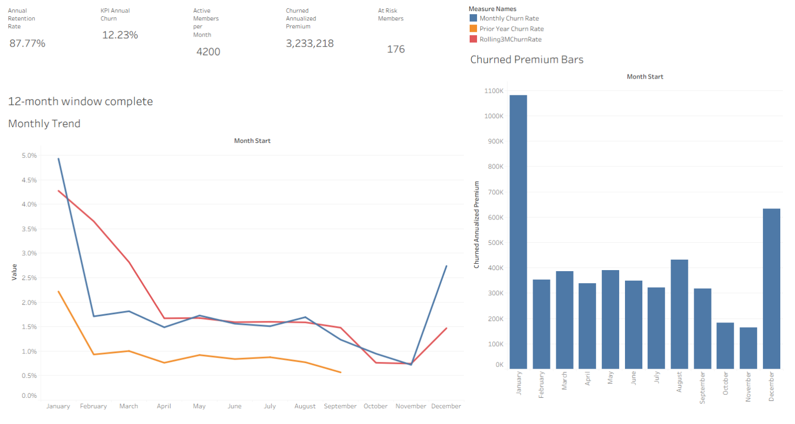
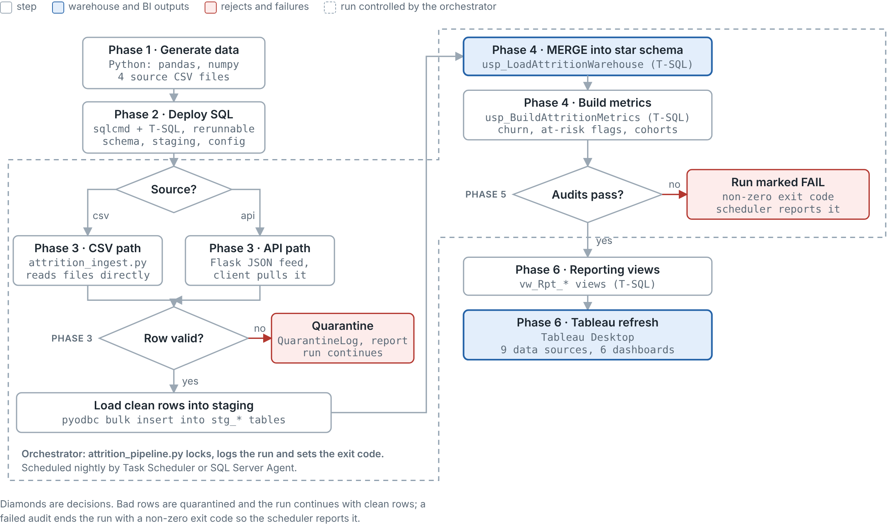

# Healthcare Attrition Pipeline Project


This project is a personal implementation of a healthcare attrition data pipeline that extracts, loads, and transforms data sources into metrics that help calculate insurance churn rate. Bridges multiple parts of the data engineering and visualization process into one codebase.



## Why I Built This

This project was the result of my interest in developing a thorough understanding of how healthcare insurance attrition rates were calculated using data engineering techniques. By getting a clearer look into the different parameters by which insurance eligibility is determined, I wanted to build a complete pipeline that extracts, transforms, and displays data parameter calculations using both Python and SQL. I utilized AI to develop domain knowledge on what parameters of health insurance were measured and built each phase of the pipeline based on synthetic data from external data files and also API ingestion. 

## Features

- Synthetic Data Generation
- Data Validation and Quarantine Operations
- Database Schema Creation 
- Transformation via Stored Procedures
- Pipeline Orchestration Script
- Data Visualization via Tableau

## Tech Stack

- **Language:** Python 3.11
- **Database:** Microsoft SQL Server
- **Visualization:** Tableau Desktop
- **Other:** pandas, pytest, pyodbc, Flask, sqlcmd, T-SQL, GitHub Actions

## Architecture



Here is the pipeline in six phases, each with the technology it uses.


**Phase 1: Generate source data** (Python: pandas, numpy)
`generate_attrition_data.py` builds synthetic members, enrollments (one row per member per month), claims and plans as CSV files. Churn, premium increases and denied claims are deliberately linked, so the metrics have a real signal to find. It can also inject bad rows to test validation.

**Phase 2: Build the warehouse and rules** (SQL Server, T-SQL, deployed with `sqlcmd`)
`deploy_attrition.sql` runs the scripts in order and can be rerun safely. It creates:
- the star schema (`DimMember`, `DimPlan`, `DimDate`, `FactEnrollment`, `FactClaims`) with constraints and a unique index that allows only one churn row per member;
- the `stg_*` staging tables;
- a configuration table holding the 15-day grace period, 12-month window and 10% renewal threshold;
- the churn and at-risk view logic;
- the audit and run-log objects.

**Phase 3: Ingest and validate** (Python: pandas, pyodbc, optionally Flask)
Data arrives by one of two paths:
- **CSV path:** `attrition_ingest.py` reads the files directly.
- **API path:** `attrition_api.py` serves the same files as paged JSON, and `attrition_api_client.py` pulls them with retries and row-count checks.


**Phase 4: Load and transform** (T-SQL)
- **Load:** `usp_LoadAttritionWarehouse` MERGEs staging into the star schema. It updates only changed rows, corrects churn flags that moved between loads, and is safe to rerun.
- **Metrics:** `usp_BuildAttritionMetrics` uses window functions to compute rolling claims, denied claims, last-renewal premium change, churn and at-risk flags. It also builds the cohort retention table.

**Phase 5: Orchestrate and audit** (Python, T-SQL, Task Scheduler or SQL Server Agent)
`attrition_pipeline.py` runs everything in order. It takes an application lock so two runs cannot overlap, logs each run to `PipelineRunLog`, runs the audit checks (row counts, orphan keys, quarantine rate), and returns an exit code. The `.bat` file and the SQL Agent job schedule it nightly.

**Phase 6: Report** (T-SQL views, Tableau Desktop)
The `vw_Rpt_*` views expose annual retention, at-risk members, renewal-increase bands and pipeline health. In Tableau each view is its own data source and sheet, and the sheets are combined into six dashboards. Refresh after each run.

92 python unit tests live in `tests/` and need no SQL Server. They cover the validators, the API and client, the orchestration flow, and the SQL logic through SQLite translations.

## Getting Started

### Prerequisites

- Python 3.11+
- SQL Server (local or Docker)
- T-SQL, pyodbc, pandas, numpy, sqlcmd, Flask
- Tableau

### Installation

```bash
git clone https://github.com/rithvik-rc/healthcare_attrition_pipeline_project.git
cd healthcare_attrition_pipeline_project
python -m venv .venv
source .venv/bin/activate      # Windows: .venv\Scripts\activate
pip install -r requirements.txt
cp .env.example .env           # then edit with your values
```

### Usage

    python src/generate_attrition_data.py
    sqlcmd -S localhost -d WarehouseDB -E -I -i src/deploy_attrition.sql
    python src/attrition_pipeline.py                       # CSV path
    python src/attrition_pipeline.py --source api --api-url http://127.0.0.1:5000

For the API path, start the feed first with `python src/attrition_api.py --data-dir output`. Details are in `src/README_api_ingestion.md`.

## Running Tests

    python -m unittest discover -s tests -v

## Project Structure

```text
    docs/    flowchart image, tableau overview + pptx file
    src/     pipeline code, SQL scripts, deploy and schedule scripts
    tests/   92 unit tests 
```

## Challenges and What I Learned

- One of the main challenges was understanding which visualizations provided the most clarity into the factors that influenced churn rate. With all the graphs created, knowing how to extract insights and summarize the importance of these data patterns took more subject matter research and application of data science principles.
- One of the main design decisions that changed the structure of this project was establishing docker containerized environments with SQL Server and Tableau. This decision helped to simulate a production environment where data ingestion was a continuous process that required task scheduling on the SQL Server side and updated visualization from the Tableau side. Understanding how to write and test robust code that ensured pipeline health became a high priority since the continuous data ingestion heavily depended on it.

## Roadmap

- Integrating this pipeline in a workforce environment where company policies can also impact healthcare insurance churn rate, which would lead to more insight on the impact of certain company policies on healthcare insurance eligibility
- Building the pipeline to be HIPAA compliant and capable of ingesting real world data.

## Contributing

Pull requests are welcome. Please open an issue first to discuss major changes.

## License

Distributed under the MIT License. See `LICENSE` for details.

## Contact

Your Name: [LinkedIn](https://linkedin.com/in/rithvik-chandrupatla-6715b61b3/) | rithvikc@gmail.com